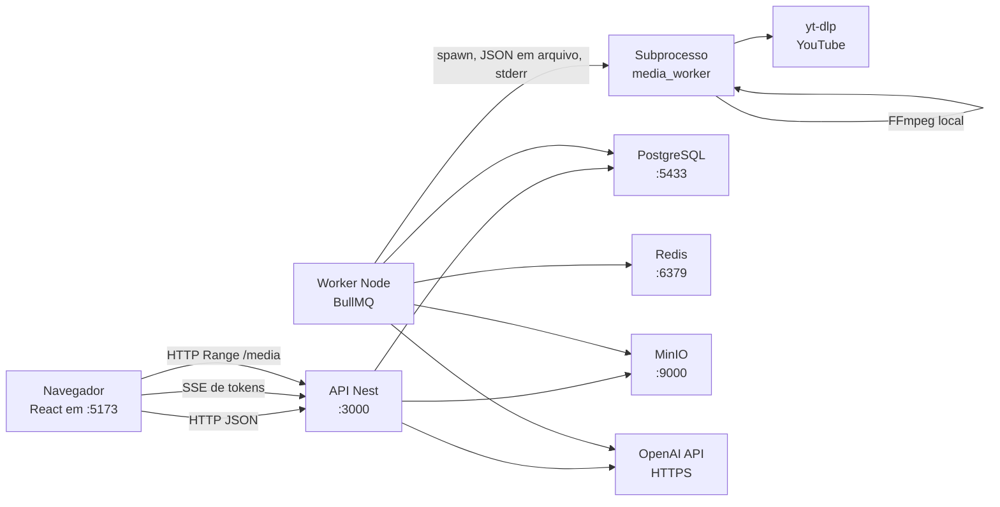
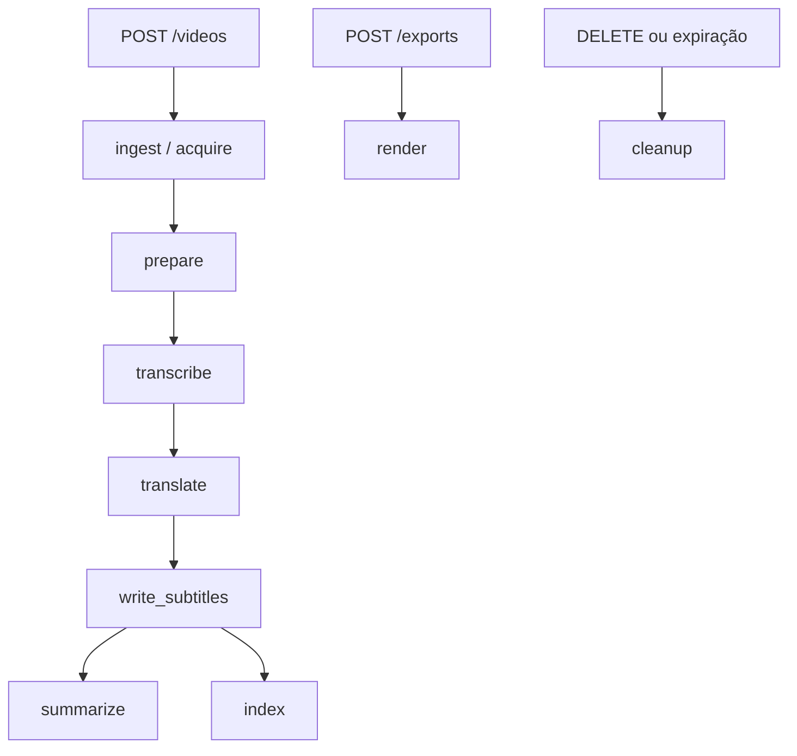
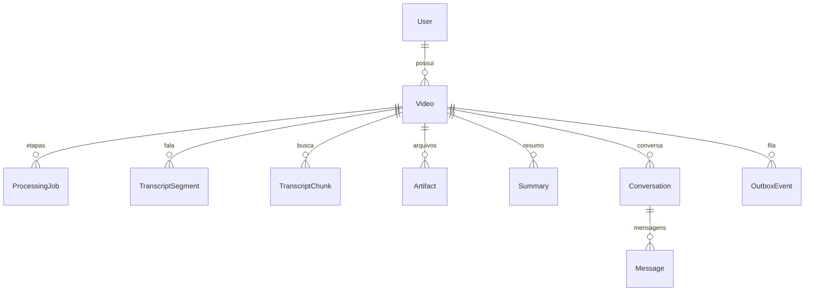

# Arquitetura atual

Registro do que o código faz em 28/10/2026. Não assume que o PRD foi seguido. Onde a execução real não foi repetida nesta leitura, o texto marca **não verificado**.

## 1. Visão geral

O produto é uma aplicação local para obter um vídeo, transcrever a fala, traduzir as legendas para português do Brasil, assistir com uma faixa WebVTT e, se a OpenAI estiver configurada, gerar resumo e responder perguntas. O áudio original é preservado. Não há dublagem. A interface anuncia um único par: inglês para português do Brasil.

A arquitetura implementada é um monólito modular em três processos Node no host, mais um subprocesso Python por etapa de mídia. A API Nest grava o pedido e um evento de outbox no PostgreSQL. O worker Node publica esse evento no Redis (BullMQ), executa a etapa e, nas etapas de mídia, inicia `python -m media_worker`. Arquivos ficam em armazenamento compatível com S3. Resumo, embeddings e chat chamam a API da OpenAI a partir do worker ou da API, nunca do navegador.

O Compose sobe apenas PostgreSQL, Redis e MinIO. API, worker e interface rodam no computador, não como serviços do Compose. Há Dockerfiles da API, do worker e do worker Python, mas eles não estão ligados ao Compose. Nesta análise eles não foram construídos nem executados: **não verificado** se as imagens sobem.

| Componente | Responsabilidade | Linguagem e framework | Processo ou contêiner | Ponto de entrada | Principais dependências |
| --- | --- | --- | --- | --- | --- |
| Interface | Formulário, histórico, player, resumo e chat | TypeScript, React 19, Vite 8, React Router 8, Tailwind 4 | Processo no host (`pnpm dev:web`). Sem contêiner no Compose | `apps/web/src/main.tsx` | TanStack Query, React Hook Form, Zod, `@video-translate/contracts` |
| API | Projetos, mídia assinada, resumo e chat em SSE | TypeScript, NestJS 12 | Processo no host (`pnpm dev:api`). Dockerfile em `apps/api/Dockerfile`, não usado pelo Compose | `apps/api/src/main.ts` | Prisma 7, OpenAI SDK, Zod, Pino, `@video-translate/storage` |
| Worker Node | Publica o outbox, consome filas, orquestra etapas | TypeScript, BullMQ, processo sem HTTP | Processo no host (`pnpm dev:worker`). Dockerfile em `apps/worker/Dockerfile` | `apps/worker/src/main.ts` | BullMQ, ioredis, Prisma, OpenAI SDK |
| Worker Python | Obtenção, FFmpeg, Whisper, Argos, SRT/VTT/ASS e MP4 gravado | Python 3.12 ou 3.13 | Subprocesso por etapa, iniciado pelo worker Node. Imagem própria em `workers/media-python/Dockerfile`, não orquestrada pelo Compose | `workers/media-python/media_worker/__main__.py` | faster-whisper, Argos Translate, yt-dlp, FFmpeg |
| Contratos | Regras compartilhadas de URL, etapas, chat e configuração | TypeScript | Biblioteca, sem processo | `packages/contracts/src/index.ts` | Zod |
| Banco | Metadados, segmentos, vetores e outbox | PostgreSQL 16 com pgvector | Contêiner `postgres` em `infra/docker-compose.yml` | Imagem `pgvector/pgvector:pg16` | Extensão `vector` |
| Fila | Entrega das etapas | Redis 7.4 e BullMQ | Contêiner `redis` | Imagem `redis:7.4-alpine` | Três filas: `media`, `intelligence`, `maintenance` |
| Objetos | MP4, WAV, legendas e JSON de segmentos | API S3 | Contêiner `minio` (`cgr.dev/chainguard/minio`) | `packages/storage/src/index.ts` | `@aws-sdk/client-s3` |

## 2. Organização do repositório

Workspaces em `pnpm-workspace.yaml`: `apps/*` e `packages/*`. O Python fica fora do pnpm, em `workers/media-python`.

| Caminho | Responsabilidade |
| --- | --- |
| `apps/web` | Interface |
| `apps/api` | HTTP, autenticação de desenvolvimento, mídia e chat |
| `apps/worker` | Orquestração. `apps/worker/test` existe e está vazio |
| `workers/media-python` | Pipeline de mídia e testes pytest |
| `packages/contracts` | Domínio compartilhado pela interface, API e worker |
| `packages/database` | Schema Prisma, cliente e a única migration |
| `packages/storage` | Cliente S3 e chave de objeto |
| `packages/config` | Só `tsconfig.base.json` |
| `infra/docker-compose.yml` | Postgres, Redis e MinIO |
| `docs` | API, decisões, validação e este registro |
| `scripts/create-sample-video.sh` | Gera um MP4 curto local |
| `var/work`, `var/local-media`, `var/prove` | Trabalho, arquivos locais autorizados e prova direta |
| `.cache` | Modelos Whisper e Argos. Não entra no build da imagem |
| `.github/workflows` | Diretório vazio. Não há pipeline de CI no repositório |

A interface importa contratos para normalizar a URL do YouTube e listar o idioma habilitado. A API e o worker importam contratos, banco e armazenamento. O worker não importa a API. O Python não importa Node: o contrato entre eles é um JSON de pedido e um JSON de resultado em disco.

## 3. Diagrama da arquitetura atual

Protocolos observados:

- Navegador e API: HTTP JSON. O chat usa `text/event-stream`.
- Fila: Redis, via BullMQ. O banco não fala com o Redis. O worker faz a ponte pelo outbox.
- Node e Python: subprocesso, sem fila e sem HTTP.
- Banco: PostgreSQL, driver `pg` pelo Prisma.
- Arquivos: API S3. A reprodução não usa URL pré-assinada do MinIO no player. A API faz o streaming em `/media/...`.
- OpenAI: HTTPS a partir da API e do worker.

Não há gateway, serviço de identidade, barramento extra nem worker Python permanente.

## 4. Fluxo completo de processamento

O pedido HTTP cria a linha do vídeo, a etapa `ingest` e um `OutboxEvent`. O worker publica o evento a cada 2 segundos. Cada etapa bem-sucedida enfileira a próxima em `nextStages` (`packages/contracts/src/domain.ts`). A renderização do MP4 legendado não entra nessa cadeia. Ela só começa com `POST /videos/:id/exports`.

Depois de `write_subtitles`, `summarize` e `index` são enfileirados juntos. A fila `intelligence` tem concorrência 2, então as duas podem correr ao mesmo tempo.

### 4.1 Validação e criação do projeto

- Módulo: `apps/web/src/pages/home-page.tsx` e `apps/api/src/videos.service.ts` (`create`).
- Entrada: URL e `targetLanguage`. A interface normaliza a URL com `packages/contracts/src/youtube-url.ts` antes do POST. A API normaliza de novo.
- Saída: projeto com `sourceKind: "youtube"`, status inicial de fila e etapa `ingest` pendente.
- Persistência: tabelas `Video`, `ProcessingJob` e `OutboxEvent`.
- Síncrono até gravar o banco. O processamento é assíncrono.
- Dependências: nenhuma etapa anterior. Exige usuário de desenvolvimento e respeita `MAX_ACTIVE_VIDEOS_PER_USER` para status `queued`, `processing` e `partial`.
- Falhas: URL inválida, playlist ou host estranho não criam projeto. Conflito de `Idempotency-Key` responde 409. A chave aceita na API tem 8 a 80 caracteres (`apps/api/src/videos.controller.ts`). `docs/api.md` ainda diz 8 a 128.
- Arquivo local: `apps/worker/src/local-file.ts` cria `sourceKind: "local_file"` sem passar pela tela. O arquivo precisa estar em `LOCAL_MEDIA_ROOT`.

A duração máxima não é conhecida na criação. O limite de `MAX_VIDEO_DURATION_SECONDS` (1800) é aplicado na obtenção, em `workers/media-python/media_worker/acquire.py`.

### 4.2 Publicação e consumo da tarefa

- Módulo: `publishOutbox` e `startWorker` em `apps/worker/src/main.ts`.
- Entrada: `OutboxEvent` com `status: "pending"`.
- Saída: job BullMQ `{ videoId, stage, version }` e o evento marcado `published`. O job correspondente passa de `pending` para `queued`.
- Assíncrono. O publicador roda a cada 2 segundos, até 20 eventos.
- Se o vídeo já pediu exclusão, o evento é `discarded`, exceto `cleanup`.
- `jobId` é o id do evento. Se o Redis responder que o job já existe, o código trata como sucesso e marca o evento publicado.
- BullMQ está com `attempts: 1`. A nova tentativa não é retry do BullMQ. Ela cria outro `OutboxEvent` em `apps/worker/src/processor.ts`.

### 4.3 Obtenção do vídeo

- Módulo: etapa `ingest`, comando Python `acquire`, `workers/media-python/media_worker/acquire.py`.
- YouTube: a URL precisa casar com `https://www.youtube.com/watch?v=` e 11 caracteres. yt-dlp baixa até 720p em MP4. Metadados têm timeout de no máximo 120 segundos.
- Arquivo local: o worker copia para `var/work/<id>/input.mp4` antes do Python.
- Saída: `source.mp4` no diretório de trabalho e artefato `source_media` no objeto `videos/<id>/v<version>/source_media/...`.
- Persistência extra: título, duração e id de origem no `Video`, quando o Python os devolve.
- Assíncrono. Depende só da criação.
- Falha permanente de origem indisponível ou duração acima do limite (`DurationExceededError`). yt-dlp ausente é transitória.
- Download real do YouTube nesta máquina: **não verificado**. O README afirma que ainda não foi executado.

### 4.4 Extração de áudio

- Módulo: etapa `prepare`, `workers/media-python/media_worker/ffmpeg_media.py` (`prepare_media`).
- Entrada: `source.mp4`.
- Saída: `playback.mp4` (vídeo de reprodução, sem legendas gravadas) e `audio.wav` PCM 16 bit, mono, 16 kHz.
- Artefatos `playback_mp4` e `audio_wav`.
- Assíncrono. Depende de `ingest`.
- Se o arquivo já está no armazenamento, `outputsExist` em `processor.ts` pula a execução.

### 4.5 Transcrição

- Módulo: etapa `transcribe`, `workers/media-python/media_worker/transcribe.py`.
- Entrada: o WAV preparado. O Python recusa outro formato.
- Modelo: faster-whisper, `device="cpu"`, `compute_type="int8"`, nome em `WHISPER_MODEL` (padrão `base`), `vad_filter=True`.
- Saída: segmentos `{ id: seg-0000, startMs, endMs, text }`, idioma detectado e duração. Artefato `transcript_json`. O worker grava `TranscriptSegment.originalText` e `Video.detectedLanguage`.
- Tempos vêm de `segment.start` e `segment.end` do Whisper, convertidos para milissegundos. Texto vazio ou fim menor ou igual ao início é descartado.
- Sem segmentos: erro permanente de fala insuficiente.
- Assíncrono. Depende de `prepare`.

### 4.6 Tradução

- Módulo: etapa `translate`, `workers/media-python/media_worker/translate.py` e `segment_groups.py`.
- Entrada: `segments.json` materializado do banco.
- Par efetivo: destino `pt-BR` mapeado para Argos `pb`. Origem Whisper `en` mapeia para Argos `en`. Se o idioma detectado já for `pt` ou `pb` e o destino for `pt-BR`, a tradução é copiada, não refeita (`languages_match`).
- Saída: `translatedText` no mesmo segmento, preservando `id`, `startMs` e `endMs`. O worker atualiza as linhas existentes.
- Pacote ausente é erro permanente de par indisponível.
- Assíncrono. Depende de `transcribe`.

### 4.7 Geração de SRT, VTT e ASS

- Módulo: etapa `write_subtitles` no pipeline Python.
- Entrada: segmentos com texto traduzido.
- Saída: artefatos `subtitles_srt`, `subtitles_vtt` e `subtitles_ass`.
- Ao sucesso, o worker marca `playbackReady` e `subtitlesReady` e o status do vídeo vira `partial`.
- Assíncrono. Depende de `translate`.
- A interface não chama mais `GET /videos/:id/subtitles/srt|vtt`. Os endpoints continuam em `apps/api/src/videos.controller.ts` e `apps/web/src/lib/api.ts`.

### 4.8 Reprodução

- Módulo: `apps/api/src/videos.service.ts` (`playback`) e `apps/api/src/media.controller.ts`.
- Entrada: vídeo com `playbackReady`.
- Saída: URL da API `/media/<id>/playback_mp4` com `user`, `expires` e `signature`, mais a trilha VTT.
- O player em `apps/web/src/components/video-player.tsx` usa `<video>` nativo e `<track default>`. Não há botão próprio de ocultar legenda. Os controles nativos fazem isso.
- Síncrono na leitura. Depende de `write_subtitles`.
- A URL expira em `PRESIGN_TTL_SECONDS` (padrão 900). A interface recalcula o intervalo de atualização a partir de `expiresAt` em `apps/web/src/pages/video-page.tsx`.

### 4.9 Exportação do MP4

- Módulo: `requestExport` na API e etapa `render` no Python (`render_burned_subtitles`).
- Não faz parte da cadeia automática. O botão da interface chama `POST /videos/:id/exports`.
- Se o artefato `burned_mp4` já existe, a API devolve `ready` sem enfileirar de novo. Se já há job `pending`, `queued` ou `running`, devolve esse job sem reiniciar.
- Entrada da renderização: `playback.mp4` e `subtitles.ass`. FFmpeg com `libx264` e filtro ASS. Não emite percentual.
- Saída: artefato `burned_mp4`. A interface mostra barra indeterminada e texto de etapa, nunca um percentual.
- Falha de `render` não marca o vídeo inteiro como `failed` (`markStageFailure` retorna cedo). O player permanece.
- Assíncrono. Depende de `playback_mp4` e `subtitles_ass`, produzidos antes.

### 4.10 Resumo

- Módulo: `apps/worker/src/intelligence.ts` (`runSummary`).
- Entrada: todos os `TranscriptSegment.originalText` da versão, com id e tempos no prompt. Não usa o texto traduzido.
- Se a transcrição passa de 60.000 caracteres, o worker resume blocos de 40 segmentos e depois consolida. O prompt pede cobertura do conteúdo inteiro.
- Saída: JSON com `overview`, `topics` e `conclusions`. `segmentIds` desconhecidos são descartados por `resolveSegmentReferences`. O resultado vai para `Summary` e `Video.summaryStatus = ready`.
- Sem chave ou sem `OPENAI_SUMMARY_MODEL`, o status vira `unavailable` e a etapa termina sem erro. O vídeo segue.
- Falha definitiva marca só `summaryStatus: failed` e mantém `partial`.
- Assíncrono. Depende de `write_subtitles`, não da renderização.
- Chamada paga quando o modelo está configurado.

### 4.11 Perguntas e respostas

- Preparação: etapa `index` cria `TranscriptChunk` de até 1200 caracteres, com embedding OpenAI e vetor `vector(1536)`. Sem modelo de embedding, `chatStatus` fica `unavailable`.
- Pergunta: `POST /conversations/:id/messages` em `apps/api/src/conversations.service.ts`.
- A API gera o embedding da pergunta, busca os 5 chunks mais próximos por cosseno e exige similaridade mínima `CHAT_SIMILARITY_THRESHOLD` (0,2). Abaixo disso, o contexto fica vazio e o prompt manda dizer a limitação.
- O contexto enviado ao modelo é o `originalText` dos segmentos escolhidos, mais os vizinhos de posição, até 12.000 caracteres. O prompt em `buildChatMessages` proíbe minutagem e ids. A interface não desenha referências no chat (`apps/web/src/components/chat-thread.tsx`).
- O servidor ainda separa uma linha `REFS:` se o modelo a emitir (`splitReferences`) e grava `segmentRefs`. Com o prompt atual, isso é residual.
- Transporte: SSE `token`, `done`, `error`. `clientMessageId` repetido devolve a resposta já gravada.
- Histórico enviado ao modelo: últimas 6 mensagens. Teto de mensagens da conversa: `MAX_CHAT_MESSAGES` (40).
- Síncrono do ponto de vista do pedido HTTP, com stream. A indexação anterior é assíncrona.
- Não há fallback para outro provedor. Sem configuração, o chat fica indisponível.

## 5. Comunicação entre Node e Python

O worker chama `runPythonStage` em `apps/worker/src/python-process.ts`.

- Início: `spawn` sem shell, processo destacado (`detached: true`), `stdio` sem stdin. O comando é `buildPythonArguments`: `python -m media_worker run --request <arquivo> --result <arquivo>`. `PYTHONPATH` aponta para `workers/media-python`. O binário padrão é `workers/media-python/.venv/bin/python`, ou `PYTHON_BIN`.
- Contrato: versão `1.0.0`. Pedido e resultado são JSON validados dos dois lados (`packages/contracts` no Node e `workers/media-python/media_worker/contract.py` no Python). O resultado é escrito em arquivo temporário e renomeado.
- Comandos permitidos: `acquire`, `prepare`, `transcribe`, `translate`, `write_subtitles`, `render`.
- Progresso e logs: uma linha JSON por stderr, `stream: progress` ou `stream: log`. O Node registra no Pino e descarta linhas com mais de 400 caracteres. Esse progresso não é gravado no banco nem chega à interface.
- Arquivos temporários: `var/work/<videoId>/request.json`, `result.json`, mídia e `segments.json`. O trabalho de prova usa `var/prove`.
- Modelos: cada transcrição sobe um processo novo e instancia `WhisperModel` de novo. O cache em disco é `download_root` em `.cache`. Argos usa `XDG_DATA_HOME` no mesmo cache. Não há modelo residente entre vídeos.
- Timeout: `STAGE_TIMEOUT_MS`, padrão 1.800.000 ms. Ao estourar, o Node manda `SIGTERM` ao grupo do processo.
- Cancelamento: a cada 2 segundos o Node relê o vídeo. Se `deletionRequestedAt` ou `deletedAt` existir, manda `SIGTERM` ao grupo (`python-process.ts`). A exclusão em `videos.service.ts` grava `var/work/<id>/cancel` e também manda `SIGTERM` ao grupo do `workerPid`. O Python só consulta `cancelFile` se esse campo vier no pedido (`pipeline.py`, `_raise_if_cancelled`), no início do comando e de novo antes de transcrever e traduzir. O worker Node não envia `cancelFile`. Sem esse campo, o arquivo `cancel` não interrompe o subprocesso. A interrupção efetiva é o sinal.
- Concorrência: a fila `media` tem concorrência 1. Duas transcrições não correm no mesmo worker. `intelligence` tem concorrência 2. Não há trava entre várias instâncias do worker além do Redis. **Não verificado** o comportamento com dois processos worker ao mesmo tempo.
- Morte inesperada: o job BullMQ não é reexecutado (`attempts: 1`). `reconcileAbandonedJobs` a cada 30 segundos procura jobs `running` mais velhos que o timeout da etapa mais 60 segundos. Se o PID não existe, volta o job para `pending` e cria outro outbox. Se o PID ainda responde a sinal 0, o job continua abandonado até o processo morrer.

## 6. Banco e armazenamento

Há uma migration: `packages/database/prisma/migrations/20261028180000_init/migration.sql`. Ela cria a extensão `vector` e o índice HNSW de cosseno em `TranscriptChunk.embedding`.

| Dado | Onde fica |
| --- | --- |
| Vídeo de origem, playback, WAV, legendas, JSON e MP4 gravado | Objeto S3 em `videos/<id>/v<version>/<kind>/<arquivo>`, tabela `Artifact` |
| Caminho local autorizado | `Video.internalSourcePath`, só para arquivo local |
| Segmento original e tradução | `TranscriptSegment.originalText` e `translatedText`, com `startMs` e `endMs` |
| Resumo | `Summary.overview`, `topics` e `conclusions` em JSON, já com referências resolvidas |
| Embeddings | `TranscriptChunk.embedding vector(1536)` e `segmentIds` |
| Conversa e mensagens | `Conversation` única por vídeo e dono. `Message.segmentRefs` em JSON |
| Estado da tarefa | `ProcessingJob.status` e `Video.status`, `currentStage`, `summaryStatus`, `chatStatus` |
| Intenção de fila | `OutboxEvent` |

Índices relevantes no schema: dono e data do vídeo, status e expiração, status e atualização do job, vídeo e versão de segmentos e chunks, conversa e data da mensagem, status e data do outbox, HNSW do embedding.

Versionamento: `Video.version` começa em 1. Jobs, segmentos, artefatos, resumo e chunks usam essa versão na chave única. Não há fluxo na interface que incremente a versão. Repetir uma etapa reusa a mesma versão.

Retenção: `expiresAt` é calculado com `RETENTION_DAYS` (7). A cada 30 segundos o worker marca vídeos vencidos como `expired`, pede limpeza e remove objetos, segmentos, resumo, artefatos e conversas (`apps/worker/src/cleanup.ts`). A linha do vídeo expirado permanece, sem título e sem URL. A exclusão manual marca `deleting` e a limpeza seguinte grava `deleted`. A lista da API omite `deleted` e `deleting`.

Backups e o que acontece com o volume do Postgres depois da exclusão lógica: **não verificado**. Não há política de backup no repositório.

## 7. Filas e confiabilidade

Filas reais, criadas em `apps/worker/src/main.ts`:

| Fila | Quem produz | Quem consome | Concorrência | Etapas |
| --- | --- | --- | --- | --- |
| `media` | Outbox, na criação, no retry e na exportação | Worker Node | 1 | `ingest`, `prepare`, `transcribe`, `translate`, `write_subtitles`, `render` |
| `intelligence` | Outbox depois das legendas | Worker Node | 2 | `summarize`, `index` |
| `maintenance` | Outbox na exclusão e na expiração | Worker Node | 1 | `cleanup` |

- Retries: até `ProcessingJob.maxAttempts` (3). Erro permanente ou código de saída 2, 3, 4, 5, 6 ou 130 não repete (`classifyStageFailure`). Não há backoff. O próximo outbox pode sair em cerca de 2 segundos.
- Idempotência do pedido HTTP: chave opcional por dono, com impressão digital da URL e do idioma.
- Idempotência da etapa: chave única `(videoId, stage, version)`. Se o artefato já existe, a etapa de mídia retorna sem chamar o Python.
- Deduplicação do BullMQ: `jobId` igual ao id do evento de outbox.
- Tarefa abandonada: reconciliador por PID e por tempo, descrito na seção 5.
- Consistência banco e fila: o outbox é a fonte. O Redis só recebe o que o publicador consegue gravar como `published`. Não há transação distribuída. Se o processo morre depois do `queue.add` e antes do update, o laço seguinte encontra o job existente e marca o evento publicado.
- Falha parcial: resumo, índice, render e cleanup não derrubam o vídeo para `failed`. Falha de ingest, prepare, transcribe, translate ou write_subtitles marca o vídeo `failed`.
- Exclusão durante processamento: a API mata o PID registrado, o worker cancela a etapa e descarta eventos que não sejam `cleanup`.

Mecanismos ausentes:

- Fila morta.
- Backoff e jitter.
- Retry do próprio BullMQ (`attempts` é 1).
- Percentual de progresso persistido.
- Bloqueio para impedir dois workers de publicar o mesmo lote. O `jobId` reduz o dano, mas o publicador não usa `SELECT FOR UPDATE`.
- Métrica de lag da fila.
- Teste automatizado do ciclo outbox, Redis e banco. `apps/worker/test` está vazio.

## 8. IA, transcrição e tradução

| Função | Biblioteca ou provedor | Onde |
| --- | --- | --- |
| Transcrição | faster-whisper 1.2.1, modelo `base`, CPU, int8 | `transcribe.py` |
| Tradução das legendas | Argos Translate 1.11.0, pacote `en` para `pb` | `translate.py` |
| Resumo | OpenAI Chat Completions, modelo só se `OPENAI_SUMMARY_MODEL` estiver preenchido | `intelligence.ts` |
| Embedding e chat | OpenAI, modelos de `OPENAI_EMBEDDING_MODEL` e `OPENAI_CHAT_MODEL` | `intelligence.ts` e `conversations.service.ts` |
| Obtenção | yt-dlp 2026.10.26 | `acquire.py` |
| Mídia | FFmpeg e ffprobe no PATH | `ffmpeg_media.py` |

Não há GPU no código. Não há fallback de Whisper para API paga, nem de Argos para outro tradutor, nem de OpenAI para outro modelo. Sem as variáveis, resumo e chat ficam `unavailable` e o player continua.

Idiomas efetivos na interface e no contrato Python: só `pt-BR`. O seletor da home mostra uma opção. Origem confirmada no contrato TypeScript: `en`. Se o Whisper detectar português, a tradução local é pulada. Outros idiomas detectados tentam o pacote Argos e falham se o par não existir.

O resumo pede JSON e ids de segmento. Ids inventados são ignorados, não corrigidos. O chat recupera contexto por vizinhos de embedding, não pela transcrição inteira. O resumo, sim, recebe a transcrição inteira, em blocos quando ela é longa.

Limites de contexto observados: 60.000 caracteres para resumir de uma vez, blocos de 40 segmentos, chunks de 1.200 caracteres, 5 chunks na busca, 12.000 caracteres no prompt do chat, 6 mensagens de histórico, 40 mensagens por conversa.

Pergunta sem apoio: similaridade abaixo de 0,2 devolve contexto vazio. O prompt manda declarar a limitação. Não há validador que impeça o modelo de responder mesmo assim. **Não verificado** com uma pergunta real sem apoio nesta leitura.

Custo: cada resumo, cada embedding de indexação e cada pergunta são chamadas pagas quando configuradas. Transcrição e tradução de legendas são locais. Não há contador de tokens no banco. O evento `summary.created` guarda o nome do modelo, não o custo.

## 9. Front-end e API

Páginas em `apps/web/src/app.tsx`:

- `/` entrada, `apps/web/src/pages/home-page.tsx`.
- `/videos` histórico, com exclusão na própria lista.
- `/videos/:videoId` player, resumo e chat.

Estado remoto: TanStack Query, cliente único em `app.tsx`, sem `staleTime` customizado. A página do vídeo consulta detalhe, status, playback, resumo, conversa, mensagens e exportação. O status repete a cada 4 segundos enquanto está na fila, processando, parcial ou excluindo. A exportação repete a cada 2 segundos até `ready` ou `failed`.

Estado local: aba resumo ou chat, pedido de seek e mutações de exportação, exclusão e envio. O chat guarda a troca em andamento no componente até a lista de mensagens invalidar.

Rotas: as de `docs/api.md`, conferidas nos controllers `videos.controller.ts`, `conversations.controller.ts`, `media.controller.ts` e `health.controller.ts`. Validação de corpo com Zod nos serviços e em `packages/contracts/src/api-schemas.ts`. Não há `ValidationPipe`.

Streaming: só o chat, por `fetch` e leitura do corpo em `chat-thread.tsx`. Não há `EventSource`. O restante é polling.

Player: elemento nativo, `crossOrigin="anonymous"`, trilha VTT com `default`. Seek vem do relógio do resumo. O chat não oferece seek.

Downloads: a tela só oferece o MP4 inteiro com legendas gravadas. SRT e VTT existem na API. A URL de mídia é assinada com HMAC-SHA256 de `userId:videoId:kind:expires` (`apps/api/src/media-signature.ts`). Expirada ou inválida responde 403. A página renova a URL de playback antes de expirar. Se o usuário atualizar no meio do processamento, o status volta pela consulta `GET /videos/:id/status`.

Erros visíveis: vídeo ausente tem tela própria com volta ao histórico. Falha de processamento mostra a mensagem do vídeo. Resumo ou chat indisponível ou falho mostra uma frase na aba. Não há botão de repetir etapa na interface, embora `api.retry` exista e a API aceite `translate`, `summarize`, `index` e `render`.

Ao excluir, a interface tira o item do cache e volta ao histórico. A lista também esconde status `deleting`.

## 10. Autenticação e segurança

O que existe:

- Autenticação de desenvolvimento: cabeçalho `X-Dev-User-Id`, 3 a 64 caracteres `a-z`, `0-9` e hífen. O guard cria o usuário se não existir (`apps/api/src/auth.guard.ts`). A interface grava `local-dev` em `localStorage`.
- Produção: `assertAuthConfiguration` recusa `NODE_ENV=production`, com ou sem identidade de desenvolvimento (`packages/contracts/src/auth-policy.ts`). Não há login, sessão, OAuth nem senha.
- Autorização: `assertOwner`. Recurso de outro usuário vira 404, não 403, no filtro de exceção.
- URL: só hosts do YouTube listados em `youtube-url.ts`. Credenciais na URL são rejeitadas. Playlists, canais e busca são rejeitados. O Python ainda exige a URL canônica antes do yt-dlp. Não há cliente HTTP genérico que busque um host arbitrário.
- Subprocesso: `spawn` sem `shell: true`. Argumentos são o módulo e dois caminhos. yt-dlp recebe a URL canônica como argumento, não uma string de shell.
- Arquivos locais: o caminho precisa permanecer dentro de `LOCAL_MEDIA_ROOT` depois de `realpath`. Caminhos do contrato Python precisam ser absolutos e ficar no diretório de trabalho.
- Mídia: assinatura e prazo. `GET /media` não usa o guard de usuário. Quem tem a query assinada baixa o arquivo. A API faz `Range`.
- Segredos: `.env` na raiz, lido no boot. Pino redacta `openaiApiKey`, `secretAccessKey` e `authorization`. Se `MEDIA_SIGNING_SECRET` estiver vazio fora de produção, o código usa um segredo fixo de desenvolvimento em `runtime-config.ts`. Esse valor não deve ir para produção. A API nem sobe com `NODE_ENV=production` hoje.
- Cota: um vídeo ativo por usuário, por padrão, e no máximo 40 mensagens por conversa. Não há limitação de taxa HTTP, nem teto de tokens, nem fila de prioridade.

O que não existe: provedor de identidade, papéis, auditoria de acesso, antivírus, rede isolada para o Python e allowlist de redirecionamentos do yt-dlp além de `--no-playlist` e da URL canônica. O comportamento do yt-dlp diante de redirect para endereço interno: **não verificado**.

## 11. Execução e implantação

Local, a partir da raiz, como no `README.md`:

1. `pnpm install`, copiar `.env.example` para `.env` e criar o venv Python com `requirements.lock`.
2. `docker compose -f infra/docker-compose.yml up -d`.
3. `pnpm --filter @video-translate/database exec prisma migrate deploy`.
4. Instalar modelos com `python -m media_worker install-models`, se ainda não estiverem em `.cache`.
5. Três processos: `pnpm dev:api`, `pnpm dev:worker`, `pnpm dev:web`.
6. Abrir `http://localhost:5173`.

Serviços que precisam estar ativos para a jornada completa: API, worker, interface, Postgres, Redis e MinIO. Sem worker, o projeto fica na fila. Sem OpenAI, player e legendas ainda funcionam. Sem modelos no cache, a transcrição tenta baixar na primeira execução. **Não verificado** nesta leitura se o cache local já está completo.

Variáveis e finalidade, sem valores:

| Nome | Finalidade |
| --- | --- |
| `NODE_ENV` | Desenvolvimento ou produção. Produção não inicia |
| `PORT` | Porta da API |
| `WEB_ORIGIN` | Origem aceita no CORS de produção |
| `VITE_API_BASE_URL` | Base da API na interface |
| `DATABASE_URL` | PostgreSQL |
| `REDIS_URL` | Redis do BullMQ |
| `S3_ENDPOINT`, `S3_REGION`, `S3_BUCKET`, `S3_ACCESS_KEY_ID`, `S3_SECRET_ACCESS_KEY`, `S3_FORCE_PATH_STYLE` | Armazenamento |
| `AUTH_MODE`, `ALLOW_DEV_IDENTITY` | Modo de desenvolvimento |
| `PYTHON_BIN` | Interpretador. Vazio usa o venv do repositório |
| `MEDIA_WORKER_FORCE_IPV4` | Força IPv4 no Python ao baixar modelos |
| `WHISPER_MODEL`, `WHISPER_BEAM_SIZE` | Transcrição |
| `MAX_VIDEO_DURATION_SECONDS` | Teto na obtenção |
| `RETENTION_DAYS` | Prazo de `expiresAt` |
| `MAX_ACTIVE_VIDEOS_PER_USER` | Cota de projetos ativos |
| `PRESIGN_TTL_SECONDS` | Validade da URL de mídia |
| `STAGE_TIMEOUT_MS` | Timeout do subprocesso e da reconciliação |
| `MAX_CHAT_MESSAGES` | Teto de mensagens |
| `CHAT_SIMILARITY_THRESHOLD` | Corte da busca vetorial |
| `FONT_FILE`, `FONT_FAMILY` | Legenda gravada |
| `OPENAI_API_KEY`, `OPENAI_SUMMARY_MODEL`, `OPENAI_CHAT_MODEL`, `OPENAI_EMBEDDING_MODEL`, `OPENAI_EMBEDDING_DIMENSIONS` | Resumo, chat e vetor. Dimensão precisa continuar 1536 enquanto a coluna não mudar |
| `LOG_LEVEL` | Nível do Pino |
| `API_PUBLIC_URL` | Base pública usada nas URLs de mídia |
| `MEDIA_SIGNING_SECRET` | HMAC das URLs. Obrigatório se um dia a produção passar da trava atual |
| `WORK_ROOT`, `MODEL_CACHE_ROOT`, `LOCAL_MEDIA_ROOT` | Opcionais. Padrões `var/work`, `.cache` e `var/local-media` |

Contêineres do Compose: `postgres` com volume `postgres-data` e healthcheck `pg_isready`, porta do host 5433. `redis` com healthcheck `PING`, porta 6379, sem volume. `minio` com volume `minio-data`, portas 9000 e 9001, sem healthcheck. API, worker e web não estão no Compose.

Hardware assumido pelo código: CPU para o Whisper `base` em int8. GPU não é selecionada. O README pede não trocar o tamanho do modelo sem medir memória. Números de RAM e tempo nesta máquina: **não verificado** nesta leitura. Há relato operacional em `docs/validacao.md`, não reexecutado aqui.

Diferença para produção: a configuração local usa identidade de cabeçalho, segredo de mídia padrão e processos no host. O cliente S3 tenta configurar CORS do bucket e ignora a resposta `NotImplemented` (`packages/storage/src/index.ts`). Por isso a reprodução passa pela API. Nesta análise o MinIO não foi consultado de novo. Não há manifesto de produção, CI, proxy, TLS nem provedor de identidade. Os Dockerfiles existem, mas não formam um ambiente de produção fechado. O Dockerfile do worker instala as dependências Python a partir de `workers/media-python/requirements.txt`, não de `requirements.lock` (`apps/worker/Dockerfile`).

## 12. Testes e observabilidade

Comando executado nesta análise, na raiz, em 28/10/2026:

`pnpm test`

Resultado: saída 0.

- `@video-translate/contracts`: Vitest, 1 arquivo, 14 testes aprovados. Cobre URL, dono, referências, chunks, mensagens do chat e classificação de falha (`packages/contracts/test/domain.test.ts`).
- `@video-translate/web`: Vitest, 3 arquivos, 6 testes aprovados. Cobre idioma único da home, seek de timestamp, envio do chat e agrupamento de intervalos.
- pytest em `workers/media-python/tests/test_subtitles_and_contract.py`: 8 testes aprovados.

Não foram executados aqui: `pnpm prove:media`, download do YouTube, suíte de API, teste do worker, Playwright. Playwright não está nas dependências. `apps/worker/test` e `.github/workflows` estão vazios.

Lacunas: nenhuma etapa de fila, banco, FFmpeg, Whisper, Argos ou OpenAI é coberta por teste automatizado no `pnpm test`. O pytest cobre contrato e legendas, não o modelo.

Observabilidade:

- Logs: Pino na API e no worker. O Python emite JSON no stderr e o worker registra `stage` e `message`.
- Correlação HTTP: `X-Request-Id` em `apps/api/src/request-id.middleware.ts`, ecoado na resposta e no corpo de erro.
- Correlação de tarefa: logs de falha incluem `videoId` e `stage`. Não há trace id atravessando API, outbox, Redis e Python.
- Métricas, tracing e custo por minuto: ausentes. `UsageEvent` grava tipos como `stage.finished`, `summary.created` e cliques de timestamp, com metadados pequenos. Não grava a transcrição no evento de clique.
- Saúde: `GET /health` responde `{ "status": "ok" }` sem consultar banco, Redis ou S3.

## 13. Diferenças em relação ao PRD

O PRD está em `PRD-Video-Legendado-Chat.md`. Várias linhas dele são propostas, não decisões fechadas. A tabela abaixo compara o comportamento do código.

| Requisito ou decisão | Implementação atual | Evidência | Situação |
| --- | --- | --- | --- |
| Três idiomas de destino | Só português do Brasil | `enabledTargetLanguages` em `packages/contracts/src/domain.ts` | divergente |
| Conta simples | Cabeçalho de desenvolvimento. Produção não inicia | `auth-policy.ts`, `auth.guard.ts` | ausente |
| URL do YouTube e rejeição de playlist | Validação antes de enfileirar | `youtube-url.ts`, `videos.service.ts` | implementado |
| Obtenção real do YouTube | Adaptador presente. Execução nesta máquina não comprovada | `acquire.py`, `README.md` | parcial |
| Até 30 minutos | Aplicado na obtenção, não na criação | `acquire.py`, `MAX_VIDEO_DURATION_SECONDS` | implementado |
| Até 720p | Formato do yt-dlp limita altura | `acquire.py` | implementado |
| Áudio original, sem dublagem | Playback e MP4 gravado reutilizam o áudio obtido | `ffmpeg_media.py` | implementado |
| Fila e retomada por etapa | Outbox, BullMQ e jobs por etapa | `apps/worker/src/main.ts`, `apps/worker/src/processor.ts` | implementado |
| Percentual fictício | Interface não mostra percentual de exportação | `video-page.tsx` | implementado |
| Transcrição com tempos | Segmentos em milissegundos | `transcribe.py`, `TranscriptSegment` | implementado |
| Tradução alinhada ao segmento | Mesmo id e tempos, texto traduzido ao lado | `translate.py`, `processor.ts` | implementado |
| Player liga e desliga legenda | Só pelos controles nativos. Não há botão da aplicação | `video-player.tsx` | parcial |
| MP4 com legendas gravadas sob demanda | Etapa `render` fora da cadeia automática | `videos.service.ts`, `domain.ts` | implementado |
| Download de SRT e VTT | API sim, tela não | `videos.controller.ts`, `video-page.tsx` | parcial |
| Resumo com GPT e tempos válidos | Implementado se o modelo existir. Ids inválidos são descartados | `intelligence.ts` | parcial |
| Chat com referências clicáveis | Contexto recuperado, mas o prompt e a tela não mostram tempos | `domain.ts`, `chat-thread.tsx` | divergente |
| Pergunta sem apoio | Limiar de similaridade e instrução de limitação. Sem garantia além do prompt | `conversations.service.ts` | parcial |
| Resumo usa a fala inteira | Transcrição completa, em blocos se for longa | `intelligence.ts` | implementado |
| Slides e imagens fora da análise | Texto na home. A página do vídeo não repete o aviso | `home-page.tsx`, `videos.service.ts` ainda devolve `limitation` | parcial |
| Falha de resumo não bloqueia o player | Status parcial e player já liberado | `processor.ts` | implementado |
| Repetir etapa pela interface | API aceita retry. A tela não chama | `videos.service.ts`, `api.ts` | parcial |
| Histórico e exclusão | Lista, exclusão na lista e na página, volta ao histórico | `history-page.tsx`, `video-page.tsx` | implementado |
| Isolamento por dono | 404 para outro usuário | `assertOwner`, filtro de exceção | implementado |
| Links temporários | HMAC e prazo na API, não URL pré-assinada do bucket no player | `media-signature.ts`, `media.controller.ts` | implementado |
| Três idiomas, pastas, editor, pagamento | Não há código de produto para isso | PRD seção 12 e árvore `apps/` | ausente |
| Métricas de custo e duração por minuto | Só eventos pontuais | `UsageEvent`, sem agregador | ausente |
| CI | Diretório de workflow vazio | `.github/workflows` | ausente |

## 14. Pontos de atenção e melhorias candidatas

Problemas observados no código, não hipóteses de produto.

1. A interface não repete uma etapa que falhou, embora a API já saiba fazer isso.
   - Evidência: `api.retry` em `apps/web/src/lib/api.ts` não é chamado por nenhuma página. `VideosService.retry` existe.
   - Cenário: tradução ou resumo falha. O usuário vê o erro e não tem ação de retomar.
   - Impacto: o PRD pede recuperação parcial. Hoje ela exige chamada manual à API.
   - Melhoria: botão de repetir nas etapas `translate`, `summarize`, `index` e `render` quando o job está `failed`.
   - Esforço: pequeno.
   - Prioridade: alta.

2. O chat não oferece o trecho clicável que o resumo oferece.
   - Evidência: `buildChatMessages` proíbe minutagem. `ChatThread` não recebe `onSeek`. `segmentRefs` ainda é gravado se uma linha `REFS:` aparecer.
   - Cenário: a pessoa pergunta e precisa voltar ao resumo para saltar no vídeo.
   - Impacto: a navegação por referência fica incompleta no chat.
   - Melhoria: decidir se o chat deve voltar a mostrar intervalos validados no servidor, sem pedir ao modelo que invente tempos.
   - Esforço: médio.
   - Prioridade: alta.

3. A nova tentativa de etapa não espera e não usa a retry do BullMQ.
   - Evidência: `attempts: 1` em `apps/worker/src/main.ts`. `classifyStageFailure` recolhe outro outbox imediato, publicado no laço de 2 segundos, até 3 vezes.
   - Cenário: yt-dlp ou a OpenAI falham por rede. Três tentativas acontecem em poucos segundos.
   - Impacto: falha transitória vira falha definitiva rápido demais.
   - Melhoria: atrasar o novo outbox conforme a tentativa, ou usar backoff do BullMQ e parar de duplicar a política.
   - Esforço: médio.
   - Prioridade: alta.

4. SRT e VTT são gerados e a tela não os entrega.
   - Evidência: artefatos e rotas em `videos.controller.ts`. A página só chama a exportação do MP4.
   - Cenário: alguém precisa da legenda solta. O arquivo está no bucket e não há botão.
   - Impacto: o critério de exportar legendas separadas fica só na API.
   - Melhoria: recolocar as duas ações se o produto ainda as quer, ou remover a expectativa do PRD.
   - Esforço: pequeno.
   - Prioridade: média.

5. `GET /health` não observa as dependências.
   - Evidência: `apps/api/src/health.controller.ts` devolve `ok` sem consulta. MinIO não tem healthcheck no Compose.
   - Cenário: o banco cai e o balanceador, se existir, continua achando a API viva.
   - Impacto: baixo no uso local de um processo. Alto se alguém usar o Dockerfile atrás de um orquestrador.
   - Melhoria: health de prontidão com banco e Redis, separado do health de processo.
   - Esforço: pequeno.
   - Prioridade: média.

6. A documentação da chave de idempotência não bate com o código.
   - Evidência: controller exige 8 a 80 caracteres. `docs/api.md` diz 8 a 128.
   - Cenário: um cliente segue o documento e recebe 400.
   - Impacto: integração externa quebra sem mudança de comportamento.
   - Melhoria: alinhar o documento ao código, ou o código ao documento, com um teste.
   - Esforço: pequeno.
   - Prioridade: média.

7. O modelo Whisper é carregado do zero a cada vídeo.
   - Evidência: cada etapa é um processo Python novo e `transcribe_audio` constrói `WhisperModel` dentro da chamada.
   - Cenário: vários vídeos curtos em sequência. O tempo de carga do `base` se repete.
   - Impacto: latência e RAM repetidas. A concorrência 1 da fila `media` evita dois modelos ao mesmo tempo neste processo.
   - Melhoria: medir antes de manter um processo Python residente. Não vale um serviço novo só por esta hipótese.
   - Esforço: médio.
   - Prioridade: baixa.

8. A imagem do worker não usa o mesmo arquivo de dependências do ambiente local.
   - Evidência: `apps/worker/Dockerfile` instala `workers/media-python/requirements.txt`. O README e o ambiente local usam `workers/media-python/requirements.lock`.
   - Cenário: a imagem é construída depois de uma atualização do lock, ou o `requirements.txt` diverge do lock.
   - Impacto: transcrição e tradução na imagem podem não ser as mesmas medidas no host. A construção da imagem nesta análise: **não verificado**.
   - Melhoria: instalar a partir do lock no Dockerfile.
   - Esforço: pequeno.
   - Prioridade: média.

9. Não há teste do caminho API, fila e banco.
   - Evidência: `pnpm test` cobre contratos, três comportamentos de tela e legendas Python. `apps/worker/test` está vazio. Não há workflow em `.github/workflows`.
   - Cenário: uma mudança no outbox ou na ordem das etapas só aparece ao processar um vídeo.
   - Impacto: regressão silenciosa no fluxo principal.
   - Melhoria: um teste do `processStage` com banco e armazenamento falsos, mais a publicação do outbox.
   - Esforço: médio.
   - Prioridade: alta.

Riscos ainda não comprovados nesta leitura:

- Download do YouTube em rede real, incluindo redirect e vídeo indisponível. O adaptador existe. A execução não foi repetida.
- Qualidade do Argos e do Whisper `base` em vídeos longos ou ruidosos.
- Dois processos worker ao mesmo tempo.
- Se o yt-dlp segue algum redirect para rede interna apesar da URL canônica.

Não proponho dividir em mais serviços. O corte atual, API, worker e subprocesso Python, já isola a mídia. O que falta é política de retry, teste do fluxo e uma decisão explícita sobre as referências do chat.

## 15. Questões para revisão conjunta

1. O chat deve continuar sem tempos, como a tela faz hoje, ou voltar a saltar para o trecho, como o PRD pede?
2. SRT e VTT saem do produto ou voltam para a tela?
3. A repetição de etapa fica só na API ou ganha botão?
4. Qual provedor de identidade substitui o cabeçalho antes de qualquer publicação?
5. O par inglês para português do Brasil permanece o único até haver uma execução medida de outro pacote?
6. O download do YouTube será aceito como capacidade do MVP mesmo sem uma execução registrada nesta máquina?
7. A dimensão 1536 do vetor fica congelada? Mudar o modelo de embedding exige outra migration.
8. Qual é o teto de custo por vídeo, já que não há medição de token?
9. Backups do Postgres e do volume do MinIO entram na promessa de exclusão ou ficam de fora do MVP?
10. Os Dockerfiles devem passar a subir no Compose, ou o desenho local de três processos continua sendo o ambiente oficial?

Informações que ainda faltam para fechar essas decisões: uma execução registrada de URL do YouTube, uma medição de tempo e memória do modelo `base` em vídeos de durações diferentes, e a escolha do provedor de identidade e dos ids de modelo da conta OpenAI que será usada.
